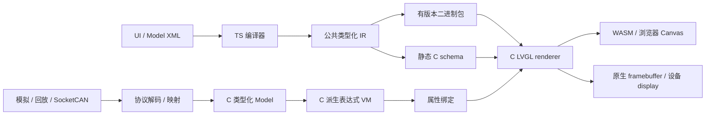

# LVGL Plus 架构

## 目标与独立实现

Plus 把仪表开发分成可独立调试的视图、状态和数据接入。XML 是工程输入，LVGL Open 是唯一实际绘图引擎；原生和 WASM 均运行 C 模型/VM/渲染适配。Pro 的公开产品理念仅作为研究输入，语言与接口均为项目独立设计。

## 模块与职责

| 模块 | 职责 | 禁止耦合 |
| --- | --- | --- |
| compiler | XML/语义检查、组件展开、表达式编译、C/包生成 | 不依赖 Node 文件系统，浏览器可复用 |
| cli | 文件边界、工程加载、事务式生成、构建、测试、截图 | 不运行工程自行提供的 shell 脚本 |
| cli 本地服务 | 编辑保存、watch、数据源、WebSocket、资源读取 | 只监听回环；写入需要会话 token |
| sdk Model/VM | 类型、批量更新、通知、有效性、命令、有界队列 | 不引用 LVGL、浏览器或具体总线 |
| sdk renderer | schema → 对象/样式/绑定、输入、生命周期 | 不解码 CAN，不实现应用业务 |
| package | 可选二进制包读取与有界检查 | 不链接到纯生成 C 的设备应用也可工作 |
| SocketCAN gateway | Linux 收帧、DBC C 解码、输出信号事件 | 无车辆控制发送路径、无 UI 指针 |
| Studio | XML 工作区、预览桥接、模型观察与注入 | 不在 JS 中重写 ViewModel 求值或用 DOM 重画仪表 |

## 关键决策

**ADR 001：独立 XML。** 不沿用 Pro `<screen>/<view>/<api>` 体系；Plus 使用 `<dashboard>/<page>`、显式 `<bind>` 和 `<use>/<fill>`，以自有语义为准。不提供 Pro 工程兼容承诺。

**ADR 002：生成静态 schema C，而非拼接不同平台 UI 实现。** 生成 C/H 将对象、属性、绑定和字节码保存为 `const` 数据，交给同一 C renderer 构建 LVGL 对象。这减少解释与生产路径的语义分叉。它不包含 XML 或二进制包解析器，但仍依赖 Plus renderer/MVVM SDK。后续若引入直接 LVGL 调用优化，必须继续通过同一一致性测试。

**ADR 003：公共 C VM。** 派生表达式编译为有界栈字节码，WASM/原生/MCU 共用求值。三元、AND 和 OR 有前向跳转，未选择分支不会产生除零等副作用。没有 `eval`、循环或任意函数调用。

**ADR 004：预览可重建，状态独立保留。** 新包先解析并创建新 Model/UI，成功后替换旧实例。同名同类型的可写状态迁移，派生值重新求值。XML 无效时本地服务继续提供最后有效包；C 扩展和核心变化需要重编译 WASM。

**ADR 005：Linux 网关与浏览器隔离。** SocketCAN 运行在原生进程；Studio 用标准信号事件接收数据。C codec 同样可链接到设备应用。浏览器不直接访问 CAN 控制器。

## 线程与生命周期

`lvp_set_*`、订阅回调、命令完成和 UI 操作运行在 UI 线程。采集线程只调用 `lvp_post`；多线程调用时应用必须提供配对 HAL lock/unlock。UI tick 从队列取出数据并在批次结束后更新派生值和绑定。

Observer 支持通知过程中取消订阅，释放延迟到通知结束。UI 销毁先解除绑定，再删除对象；Context 销毁必须晚于 UI，schema/包又必须晚于 Context。不要在回调里销毁 Context。

## 实现边界

当前包解释器可在普通 C 环境使用，但尚未形成设备更新协议、兼容升级或原子包切换产品流程。目标设备仍需自行提供 BSP、显示缓冲、输入、时钟及调度。资源预算、完整动画、字体转换和 Figma 工作流在路线图中，不用现有基础接口冒充已交付功能。
