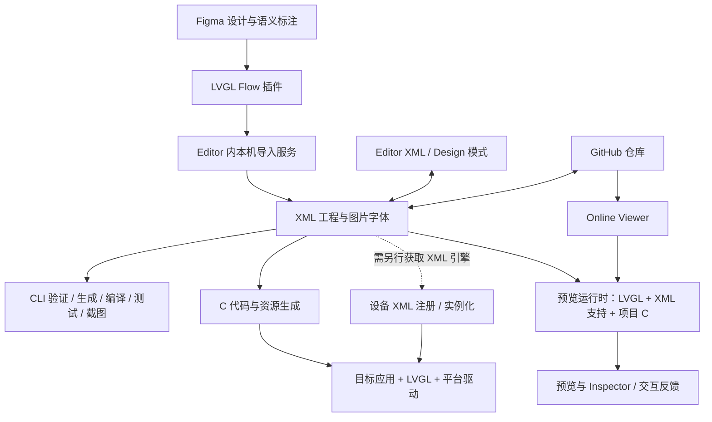

# 03 · 技术架构与数据流

## 1. 架构认知的证据边界

以下是根据官方接口、文档、发布记录和样例构建出的**逻辑架构**。公开仓库未提供完整产品实现，因此不能据此断言闭源模块的类名、进程模型、通信协议、AST 结构、缓存策略或增量生成算法。

已证实的技术锚点包括：VS Code 风格编辑环境；发布记录出现 Theia；XML 控件 API 元数据；真实 LVGL 预览；Emscripten 工具链；CMake；生成 C/H；Figma 插件与本机服务；CLI 与授权 token。Electron、Monaco、后端框架、WebSocket/HTTP 的具体使用方式不在本次证据覆盖范围内。

来源：[编辑器](https://lvgl.io/docs/pro/editor/overview)、[v2.0.0 发布](https://github.com/lvgl/lvgl_pro/releases/tag/v2.0.0)、[CLI](https://lvgl.io/docs/pro/cli)。

## 2. 总体分层



图中 Viewer 与本地预览是逻辑上的同类能力，不表示它们共享同一个进程或部署实例。CI 的编译目标也应与设备固件编译区分。

## 3. 共同工程模型

| 输入 | 职责 | 下游消费者 |
| --- | --- | --- |
| `project.xml` | LVGL 版本、工程名称、theme、target/display/memory、包含目录 | Editor、CLI、工程加载/生成流程 |
| `globals.xml` | 全局常量、字体、图片、Subject、共享样式 | 组件解析、预览、代码生成 |
| `components/*.xml` | 组合对象树、公开参数、slot、局部资源、动画 | 其他组件与屏幕、生成器 |
| `widgets/*.xml` + C | 控件接口及 C 实现/解析桥接 | 预览编译、固件编译 |
| `screens/*.xml` | 屏幕结构、导航目标、生命周期配置 | 预览、生成 C、运行时加载 |
| `translations.xml` | 多语言 key/value | 翻译模块、生成器 |
| `<test>` XML | 测试 UI、动作序列、断言与截图 | Editor Test 面板、CLI |
| 图片/字体源文件 | 资源转换或运行时读取 | 转换工具、目标文件系统/Flash |

官方推荐但不强制统一子目录。`project.xml` 和 `globals.xml` 是主要入口。项目名称决定生成头文件和初始化函数名称。包括其他工程的 `<folders>` 当前只处理一层，不能视作递归包管理器。

来源：[项目模型](https://lvgl.io/docs/pro/syntax/project)、[测试](https://lvgl.io/docs/pro/syntax/testing)。

## 4. 从 XML 到 C 的逻辑流水线

下面是架构推断，表达必要职责，不代表生成器内部真实模块划分：

1. **工程发现**：读取版本、target、globals、组件与控件定义，定位资源。
2. **语义检查**：核对标签、属性、枚举、类型、必填参数、名称引用和定义顺序。
3. **语义映射**：把 UI 标签映射到创建函数，属性映射到 setter，part/state 映射到 selector，事件映射到回调注册。
4. **实例代码生成**：输出屏幕/组件创建函数；Widget 输出骨架、内部结构及扩展 hook。
5. **资源与初始化生成**：转换图片/字体，初始化 Subject、样式、翻译等共享数据。
6. **构建清单生成**：形成 CMake 库及源文件列表，供预览或固件应用链接。

映射示意：

```text
<lv_label text="Hello"/>
    → lv_label_create(parent)
    → lv_label_set_text(label, "Hello")

<event_cb callback="on_apply" trigger="clicked"/>
    → lv_obj_add_event_cb(obj, on_apply, LV_EVENT_CLICKED, ...)
```

示意仅表达 API 关系，实际变量命名、公共初始化与生成文件布局由工具决定。Component 的 prop 变成创建函数参数，而不是自动生成一组可变 setter。

来源：[API 映射](https://lvgl.io/docs/pro/syntax/api)、[事件](https://lvgl.io/docs/pro/syntax/events)、[导出代码](https://lvgl.io/docs/pro/integration/using-exported-c-code)。

## 5. 真实 LVGL 预览与编译边界

XML 能被预览运行时解释后构建 LVGL 对象树，因此普通结构/样式调整可以绕过整套设备固件重编译。CLI 文档说明，预览/测试 runtime 包含 LVGL、项目 UI C 代码及编辑器专用 C 代码；`compile --target editor|cli` 用于不同宿主用途。

Emscripten 工具链的使用有发布说明和 CI 文件佐证，说明产品存在将 C/LVGL 编译为浏览器可执行形态的路径。将该路径概括为 WebAssembly 预览是合理的架构归纳；公开资料不足以确认具体 JS/WASM 桥接口、内存共享、Inspector 协议或 hot reload 的实现。

需要重编译的典型内容包括自定义 Widget C、业务回调、LVGL 配置以及要求最终颜色格式的编译型图片。图片尚未重编译时可能用原始 PNG 回退显示，不能把回退显示当成最终 RGB565 等格式效果。

还存在一条独立的**本地模拟器**路径：`sim/` 用 CMake 链接导出的 `lib-ui`，Linux/macOS 使用 SDL，Windows 使用 Win32，运行生成的 C。它适合验证生成产物和调试 C，与编辑器中即时 XML 预览应分别验收。

来源：[CLI compile](https://lvgl.io/docs/pro/cli)、[图片](https://lvgl.io/docs/pro/syntax/images)、[Simulator](https://lvgl.io/docs/pro/integration/simulator)、[公开 CI](https://github.com/lvgl/lvgl_pro/blob/9380417dde7ec0a2aaae1063c95b7524342b6270/.github/workflows/pr-check.yml)。

## 6. 两条设备交付路径

| 维度 | 导出 C 后编译 | 设备运行时加载 XML |
| --- | --- | --- |
| 设备输入 | C/H 与转换后的资源 | XML、资源、已编译 Widget/回调 |
| UI 实例化 | 生成创建函数调用 LVGL C API | XML 引擎解析定义并创建对象 |
| XML 是否必须随设备发布 | 否 | 是，或包含在 blob 中 |
| UI 更新 | 通常需重建/发布代码；文件资源可独立管理 | 可以只更新 XML/资源，但只能使用固件已有能力 |
| 额外引擎 | 不要求 XML 引擎 | 要求当前非公开提供的 XML 引擎 |
| 性能/内存 | 无设备端 XML 解析开销；资源和对象仍耗内存 | 额外解析、注册表与描述数据开销待测 |
| 自定义 Widget | 编译 C 实现 | 仍须预编译并注册 create/apply 处理器 |

运行时加载的公开接口流程是：注册 Widget → 注册外部事件/资源/Subject → 注册 globals/Component/Screen → 创建屏幕 → `lv_screen_load()`。组件注册只是保存定义，不等同于创建所有对象。

文档还描述 FrogFS blob 将 XML、字体、图片打包，通过 data/file 接口加载，返回可交给 `lv_xml_unload` 的句柄。卸载时的对象引用、资源生命周期和失败回滚需要实测，不能只凭接口存在就确认可安全热替换任意活动界面。

来源：[运行时加载接口](https://lvgl.io/docs/pro/integration/loading-xml-files)。

## 7. Figma 与 Viewer 的协作边界

Figma 插件负责读取设计和图层语义，Editor 内服务负责写文件。服务在本机监听预设端口，Alpha 文档示例为 9111/9112；这不足以推断具体传输协议。它管理 `.lvgl-flow/` 中的命名和导出状态，并以文件 ownership 标记保护开发者接管的文件。

Viewer 从 GitHub 载入工程，提供浏览器交互评审；当前不能重新编译用户 C，也不能保存 XML 修改。私有库访问需要 GitHub 权限及合适订阅/产品授权，不是拿到预览 URL 就有权访问仓库。未获得源码或网络实测，不能判断 Viewer 的服务端缓存、日志保留或私有代码数据驻留策略。

来源：[Figma 入门](https://lvgl.io/docs/pro/figma/get-started)、[所有权](https://lvgl.io/docs/pro/figma/updating)、[连接排障](https://lvgl.io/docs/pro/figma/troubleshooting)、[Viewer](https://lvgl.io/docs/pro/online-viewer)。
