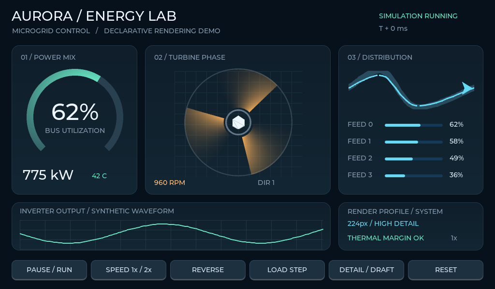

# Aurora Energy Console / 微电网能源控制台

独立设计的复杂仪表展示工程，用于验证 LVGL Plus 通用渲染能力。界面为 1024×600，含 68 个节点、53 个信号；应用源码只有 XML、Model、工程配置和测试配置，没有自定义 C 控件、外部设计素材、网络服务或设备连接依赖。界面中的负载、功率、温度及转速均为合成演示数据。



## 运行

先按仓库根目录 README 安装依赖、构建标准 WASM 与工具链，然后在仓库根目录执行：

```sh
node packages/cli/dist/main.js dev examples/energy-console --port 5181
```

打开命令输出的地址。此工程使用内置字体和公共 WASM，无需构建项目专用字库或编写 C 注册代码。生产 C 路径：

```sh
node packages/cli/dist/main.js generate examples/energy-console
node packages/cli/dist/main.js build examples/energy-console --generated
```

所有产物位于忽略目录 `.lvglplus/`，不要把用户逻辑放入生成目录。

## 可验证能力

| 区域 | 通用能力与观察点 |
| --- | --- |
| Power mix | 环形扇区、角向渐变、透明内圈、动态 endAngle 和填充色；切换过载后温度、负载环及告警同步变化，环表可跨过 0° |
| Turbine phase | 三个扇区组合旋转转子；非线性角向拖尾、径向衰减、子像素边缘、中心孔、多层叠加；六边形轮毂反向旋转 |
| Distribution | Catmull–Rom 路径、虚线、动态控制点和透明度；有界集合生成四条馈线及数值绑定 |
| Inverter output | 12 个独立点绑定驱动连续曲线；过载振幅越过绘图区，由父 panel 裁剪，不能泄漏到下方按钮区 |
| Render profile | 相同几何分别使用 224px 和 64px 覆盖缓存，直接比较细节；卡片背景使用线性渐变 |
| Controls | 原子动作、独立时钟、暂停/倍速/反转、负载切换、精度切换和复位；鼠标/触摸与语义键盘输入 |

按钮与画布聚焦后的键盘输入：

| 按钮 | 按键 | 行为 |
| --- | --- | --- |
| PAUSE / RUN | Enter | 冻结/继续 Model 时钟与动画，暂停时 RPM 为 0 |
| SPEED 1x / 2x | 右方向键 | 切换时钟倍率 |
| REVERSE | 左方向键 | 反转转子方向 |
| LOAD STEP | 上方向键 | 切换正常/过载；过载值为 94%、86 C |
| DETAIL / DRAFT | 下方向键 | 切换 224px / 64px 转子覆盖精度 |
| RESET | Esc | 原子恢复全部输入和 Model 时钟初始值 |

## 自动化验收

```sh
pnpm test:energy
node packages/cli/dist/main.js test examples/energy-console --json
node packages/cli/dist/main.js test examples/energy-console --generated --json
```

`pnpm test:energy` 比较初始、运行、过载、暂停、倍速反转、低精度和复位七类场景。每个场景要求原生包解释、生成 C、WASM 的图像全像素、对象边界、Model 值与质量一致；另检查模型复位、可见动画变化、精度差异、裁剪边界和真实 LVGL 按钮输入。

`baselines/` 保存已检查的初始、过载和低精度图像。缺失或不匹配默认失败。只有检查预期视觉变化后，才运行 `node tests/energy-console-parity.mjs --update-baselines`。运行证据写入忽略目录 `.lvglplus/parity/`；公共 CI 会运行该测试并上传证据。

## 资源与范围

每个转子叶片的 A8 覆盖缓存：224×224 = 50,176 字节，64×64 = 4,096 字节。示例以隐藏两组对象的方式切换静态 rasterSize；隐藏不会释放已创建的缓存，两档均显示过后会保留两组覆盖图。因此这是精度对比，不是实时释放内存或性能基准。还需计入其他扇区、刷新临时内存、显示缓冲和 LVGL 旋转图层；真实 MCU 的总内存与帧率需单独测试。

图像比较要求相同操作序列下三路径精确一致；复位检查全部模型状态，不要求 LVGL 不同局部刷新历史之间的图像二进制相同。波形是当前时钟生成的空间采样，不是设备历史记录。该工程不包含真实能源控制、物理涡轮仿真或安全保护逻辑。

通用属性与边界见 [声明式渲染规范](../../docs/lvglplus/declarative.md)。
